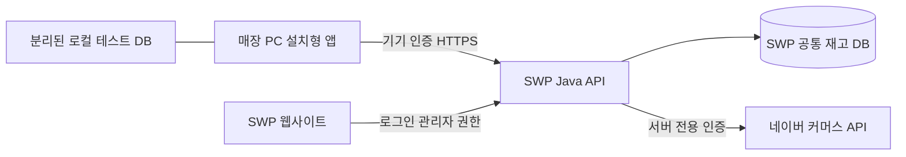

# SWP 웹사이트·설치형 재고관리·스마트스토어 연결

## 구성



매장 모드는 기존 SWP의 `cards.stock`와 이력을 사용합니다. 이 수량은 **판매가능 수량**입니다. 주문 접수 때 차감되고 취소 때 복구되므로 수령 완료 때 다시 차감하지 않습니다. 로컬 테스트 DB는 운영 원장이 아니며 자동 이전하지 않습니다.

네이버와 SWP DB는 하나의 원자적 트랜잭션으로 묶이지 않습니다. 채널 간 수집·전송 지연과 충돌이 존재하며 마지막 한 개의 동시 판매를 완전히 방지한다고 보장하지 않습니다. 실제 운영 전 안전재고·배분 정책과 장애 대사를 검증해야 합니다.

## 스마트스토어 개설

현재 실제 스토어 개설은 완료되지 않았습니다. [판매자센터](https://sell.smartstore.naver.com/)에서 커머스 ID 로그인, 개인 판매자 선택, 본인 인증, 실제 스토어·배송·정산 정보를 직접 입력합니다. 비밀번호·본인 확인 자료·정산 정보·API 비밀키는 채팅에 보내지 마세요.

개인 판매자에서 사업자등록 후 사업자 판매자로 전환할 수 있으며 대표자 동일 조건과 서류 심사가 있습니다. 실제 지속 판매를 시작할 때 사업자등록 의무를 별도로 확인합니다. 근거: [네이버 사업자 전환](https://help.sell.smartstore.naver.com/faq/content.help?faqId=3759), [가입 절차](https://help.sell.smartstore.naver.com/faq/content.help?faqId=3657), [국세청 사업자등록](https://ems.nts.go.kr/nts/cm/cntnts/cntntsView.do?cntntsId=7776&mi=2443).

일반 판매자용 테스트 스마트스토어·샌드박스는 제공되지 않습니다. 개발은 격리 DB와 테스트 HTTP 응답을 사용합니다. 실제 스토어의 API 검증에는 운영 규칙이 적용됩니다. [네이버 공식 답변](https://github.com/commerce-api-naver/commerce-api/discussions/3663)

## 연결 순서

1. SWP 웹사이트/API를 실행하고 관리자 로그인을 확인합니다. 기존 카카오 앱을 사용합니다.
2. **상점 관리 → 재고관리 앱**에서 일회성 코드를 발급해 프로그램을 연결합니다. 이 단계부터 SWP 재고를 관리할 수 있습니다.
3. 스토어 개설 후 통합 매니저 계정으로 [커머스API센터](https://apicenter.commerce.naver.com/ko)의 내 스토어 애플리케이션을 등록합니다.
4. 실제 네이버 API를 호출하는 **Java 서버의 공인 고정 IP**와 상품·주문 API 권한을 설정합니다.
5. 서버의 Git 제외 `.env.shop` 또는 호스팅 환경 변수에 `SMARTSTORE_CLIENT_ID`, `SMARTSTORE_CLIENT_SECRET`을 설정합니다. 프로그램·웹 프론트에는 넣지 않습니다.
6. 프로그램에서 연결 상태를 새로고침하고 원상품·옵션을 조회해 내부 상품 코드와 명시적으로 연결합니다.
7. 실제 수량과 기존 미출고 주문을 확인한 뒤 상품별 초기 기준을 검수합니다. 최근 주문·부분 취소·미확인 효과가 있으면 차단합니다.
8. 처음에는 `SMARTSTORE_SYNC_ENABLED=false`, `SMARTSTORE_AUTO_SYNC_ENABLED=false`로 읽기·매핑·주문 수집을 확인합니다. 지정 상품의 실검증 후 송신을 허용합니다.
9. `SMARTSTORE_SYNC_ENABLED=true`는 송신 허용입니다. 자동 실행에는 추가로 `SMARTSTORE_AUTO_SYNC_ENABLED=true`가 필요합니다. 둘 다 기본 false입니다.

새 PC는 별도 코드로 연결합니다. 잃어버린 PC의 권한은 웹에서 해제합니다. 관리자 권한 상실·만료·폐기된 기기는 접근이 차단됩니다. 키·토큰을 로그나 코드로 출력하지 마세요.

## 동기화 규칙

- 모든 SWP 재고 변경이 단조 증가 버전을 갱신합니다. 설치형 요청은 예상 버전과 UUID로 충돌·중복을 막습니다.
- 매핑만으로 송신하지 않습니다. 원격 수량 일치·기존 주문 확인·주문 피드 검수 후 초기 기준을 확정합니다.
- 상품주문번호별 효과와 주문 수집 진행 위치를 저장합니다. 재수집·취소 재조회가 중복 차감·복구되지 않도록 합니다.
- 기준 이전의 효과 불명확 주문, 반품·교환·부분 클레임, 부족 재고는 자동 보정하지 않습니다.
- 전송 전 네이버 수량을 예상 수량과 대사합니다. 불일치를 과거 원장 수량으로 무조건 덮어쓰지 않습니다.
- 반영 후 네이버 조회로 확인합니다. 응답 유실·확인 실패는 `UNKNOWN`으로 두고 자동 재전송하지 않습니다.
- 한 번에 최대 20개 상품을 처리하고 상품별 결과를 표시합니다. 일부 실패를 전체 성공으로 표시하지 않습니다.
- 네이버 상품명 검색은 **현재 페이지 안에서 필터링**합니다. 다음 페이지도 확인해야 합니다.

`UNKNOWN`, 초기 주문 충돌, 부분 수량 변경은 판매자센터에서 실제 주문·재고 확인이 필요합니다. 운영 DB를 직접 고쳐 차단을 우회하지 마세요. 라이브 적용 전 실제 대사 절차를 검수해야 합니다.

## 웹사이트 빌드·배포

기존 React 상점 화면과 Java API를 **하나의 JAR**로 묶습니다. 공개 주소나 호스팅 계정은 아직 정해지지 않았으며 빌드만으로 공개 배포가 완료되는 것은 아닙니다.

```powershell
# 저장소 루트, frontend 의존성 설치 후
./scripts/build-shop.ps1
```

결과 `backend/target/swp-shop-0.2.0.jar`는 `/` 웹사이트와 `/shop-api`를 같은 서버에서 제공합니다.

```text
docker build -t swp-shop-inventory:0.2.0 .
```

Docker 빌드에는 `.env`, DB·백업·개발 캐시·설치형 산출물을 포함하지 않습니다. 실행 환경에 기존 PostgreSQL 연결과 카카오 설정을 제공해야 합니다. 컨테이너의 임시 파일 DB를 운영 DB로 사용하지 마세요. 기존 Neon 데이터 이전·초기화를 실행하지 않습니다.

공개 운영에는 HTTPS Java/Docker 서버, 기존 DB 접속 설정, 최종 주소에 맞춘 `SHOP_ORIGIN`과 기존 카카오 Redirect URI(`https://최종주소/shop-api/auth/callback`), 네이버 API용 고정 출발 IP가 필요합니다. 서버가 쉬거나 PC가 꺼지면 수집·자동 반영도 중단됩니다. 웹 화면만 정적 호스팅하면 Java 재고 API와 네이버 연동은 실행되지 않습니다.

결제·택배 발송은 여전히 이번 범위 밖입니다. 운영 DB·실제 스마트스토어에는 검증용 상품·주문을 입력하지 않습니다. 실제 네이버 인증·쓰기·주문 수집은 스토어 개설과 사용자 설정 후 검증해야 합니다.

## 이번 작업의 로컬 미리보기

`http://127.0.0.1:18044/`에서 Docker로 실행한 빈 메모리 DB 웹사이트를 확인할 수 있습니다. 인터넷 공개 주소가 아니며 실제 상품·계정·카카오 키는 연결하지 않았습니다. 미리보기 데이터는 재시작 시 보존되지 않습니다. 미리보기를 닫으려면 `docker stop swp-inventory-preview-20261103`을 실행합니다. 운영용 DB 설정으로 바꾸거나 기존 Neon을 연결해 테스트하지 마세요.
